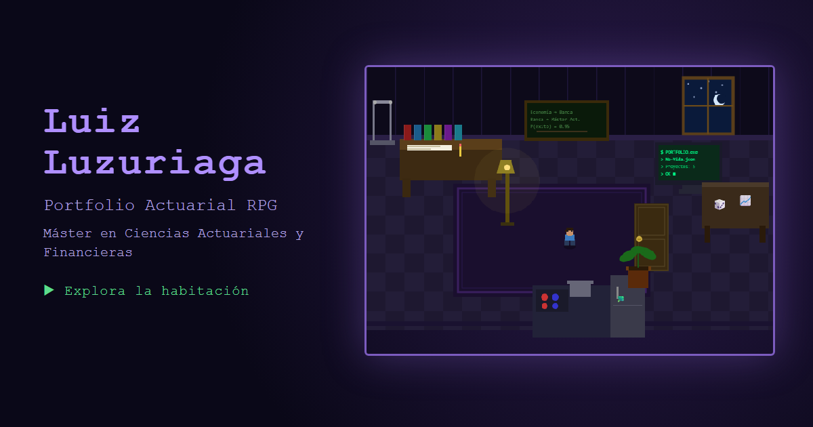

# Actuariales — Portfolio Actuarial RPG

[](https://luizluzuriaga.github.io/Actuariales/)

Portfolio interactivo de **Luiz Luzuriaga**, estudiante del Máster en Ciencias Actuariales y Financieras (Universidad de Alcalá). En vez de un CV de texto, es una habitación en pixel art: te mueves por ella y cada objeto abre un minijuego actuarial que enseña una parte del perfil.

**Web:** <https://luizluzuriaga.github.io/Actuariales/>

## Qué hay en la habitación

| Objeto | Qué abre |
|---|---|
| Mesa de estudio | Tabla de mortalidad profesional: la trayectoria como tabla biométrica (qₓ, lₓ) |
| Pizarra | Cadena de Markov con las etapas de la carrera y sus probabilidades de transición |
| Ordenador | Proyectos presentados como pólizas No-Vida (ramo, prima, cobertura) |
| Escritorio lateral | Simulación Monte Carlo de 1.000 trayectorias, con histograma y percentiles |
| Cocina | Calculadora de prima pura E[X] = Σ pᵢ·vᵢ·wᵢ con sliders |
| Barra de dominadas | Perfil deportivo |
| Ventana | CV completo |

## Cómo se usa

- **Teclado:** flechas o WASD para moverte, `E` junto a un objeto, `Esc` para cerrar.
- **Ratón:** clic en un objeto o en el mapa de secciones.
- **Móvil:** cruceta y botón `E` bajo la habitación.
- **Sin jugar:** la pantalla de inicio tiene accesos directos a cada sección.

## Estructura

```
docs/                 Web publicada con GitHub Pages (carpeta /docs de la rama main)
  index.html          Maquetación, metadatos SEO y Open Graph
  style.css           Estilos y diseño adaptable (móvil, táctil, movimiento reducido)
  game.js             Motor del juego: dibujo en canvas, movimiento, zonas interactivas
  modals.js           Contenido y lógica de cada minijuego
  main.js             Inicio y accesos directos
  img/og-card.png     Imagen de vista previa al compartir el enlace
Actuariales.qmd       Informe actuarial en Quarto (PDF)
*.ipynb               Cuadernos de Python: carteras, martingalas y el informe
```

No hay dependencias ni paso de compilación: HTML, CSS y JavaScript sin librerías.

## Ejecutarlo en local

```bash
cd docs
python -m http.server 8000
# abrir http://localhost:8000
```

## Accesibilidad

Navegación completa con teclado, foco atrapado y devuelto al cerrar cada panel, etiquetas ARIA, contraste AA en los textos, letra mínima de 11 px y respeto de `prefers-reduced-motion`.

## Licencia y contacto

Contenido personal de Luiz Luzuriaga. [LinkedIn](https://www.linkedin.com/in/luiz-luzuriaga-izquierdo) · [Atlas Gedankenpalast](https://luizluzuriaga.github.io/Gedankenpalast/)
